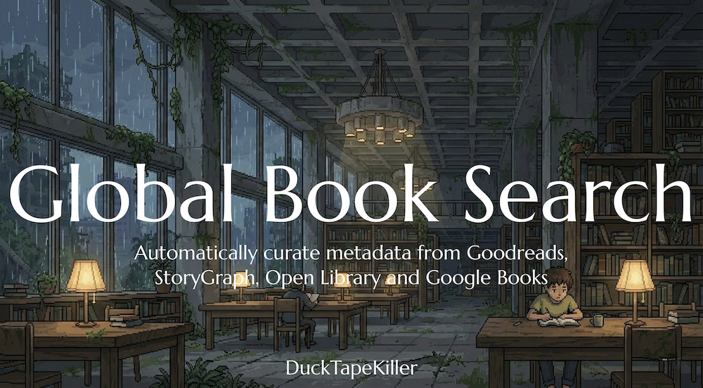
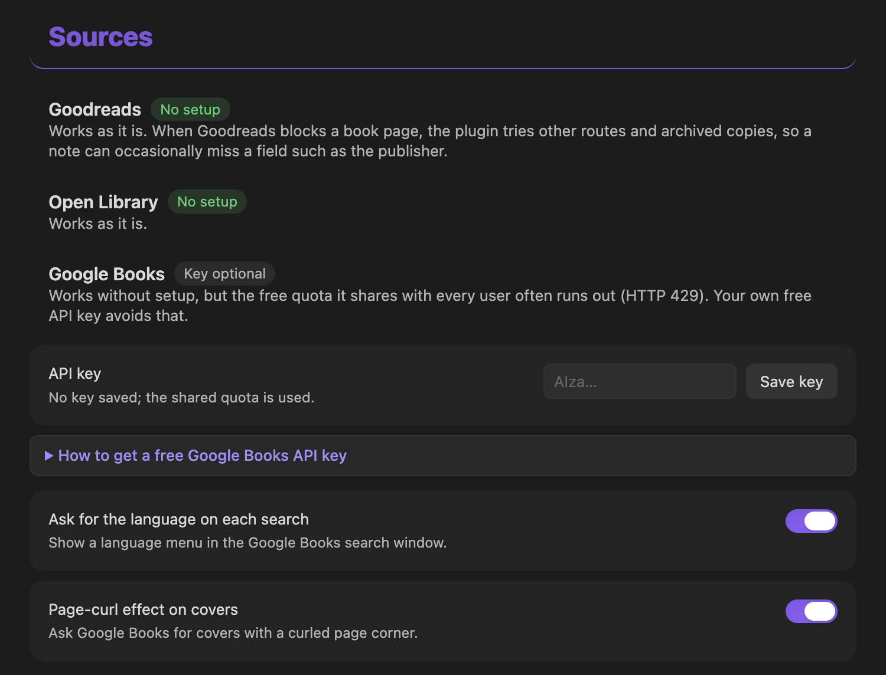
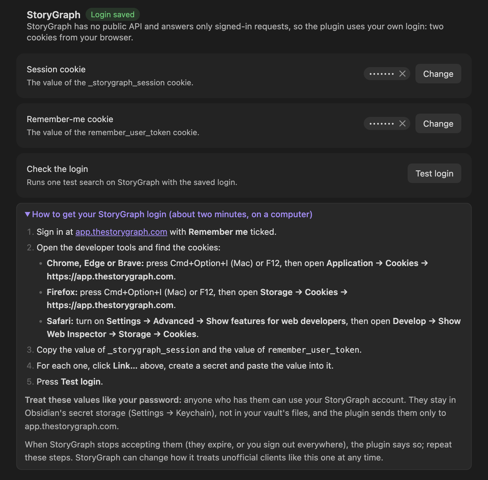
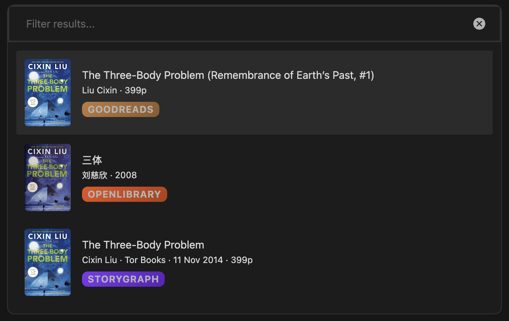
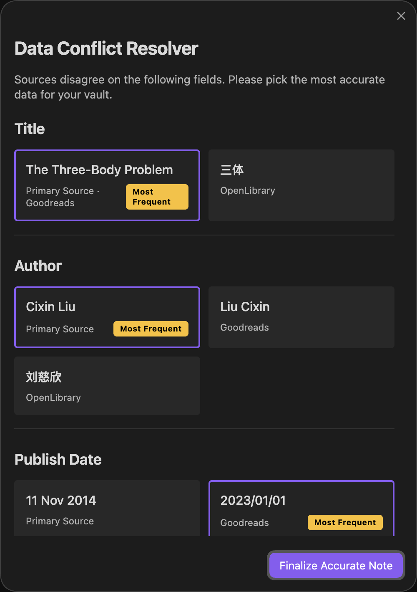
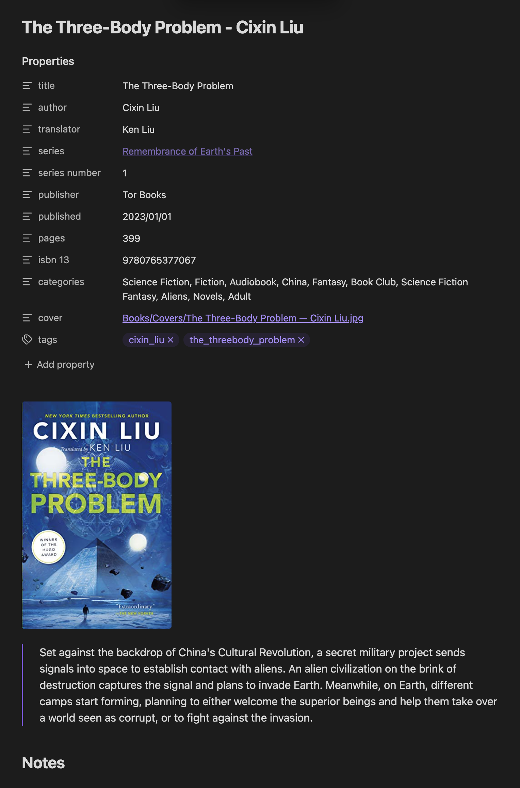
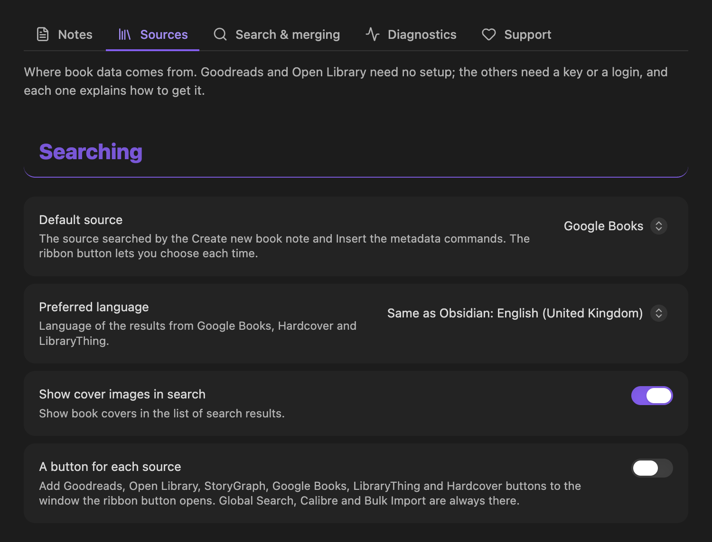
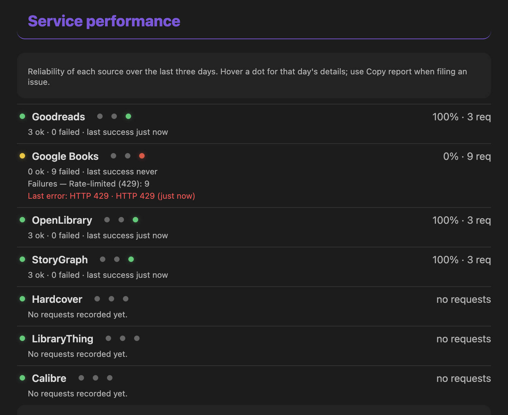

<h1 align="center">Global Book Search</h1>

<p align="center">
  <strong>Book notes for Obsidian, built from the best of Goodreads, StoryGraph, Google Books, Open Library, Hardcover, LibraryThing and your own Calibre library.</strong>
</p>

<p align="center">
  <a href="https://community.obsidian.md/plugins/global-book-search"></a>
</p>

<p align="center">
  <a href="https://github.com/DuckTapeKiller/global-book-search/releases"></a>
  <a href="https://github.com/DuckTapeKiller/global-book-search/blob/main/manifest.json"></a>
  <a href="https://github.com/DuckTapeKiller/global-book-search"></a>
  <a href="https://github.com/DuckTapeKiller/global-book-search/issues"></a>
  <a href="https://github.com/DuckTapeKiller/global-book-search/issues?q=is%3Aissue+is%3Aclosed"></a>
</p>

Search one source or all of them at once, pick the book, and get a note with its title, authors, translator, publisher, pages, ISBNs, genres, description, series and cover, laid out by your own template. When sources disagree, you choose which one wins, field by field.

## Contents

- [Highlights](#highlights)
- [Quick start](#quick-start)
- [Sources](#sources)
- [How a note is built](#how-a-note-is-built)
- [Templates](#templates)
- [Commands](#commands)
- [Settings](#settings)
- [Calibre](#calibre)
- [Mobile](#mobile)
- [Privacy and your data](#privacy-and-your-data)
- [Troubleshooting](#troubleshooting)
- [Installation](#installation)
- [Support and credits](#support-and-credits)

## Highlights

- **Every major book source in one search.** Goodreads, StoryGraph, Google Books, Open Library, Hardcover and LibraryThing, with the results grouped by book and labelled by source.
- **Fills the gaps for you.** Once you pick a book, the plugin looks it up by ISBN in the other sources and fills in whatever the first one was missing.
- **Your template, your language.** Ready-made frontmatter in 11 languages, or your own template file, with Templater support.
- **Series, translators and editions.** `{{series}}`, `{{seriesNumber}}` and a `[[wikilink]]` to the series; translators from StoryGraph and Goodreads; an edition picker when a book has several ISBNs.
- **No duplicates.** Before creating a note it checks your notes folder by ISBN and by file name, and offers to open or update the note you already have.
- **Covers saved in your vault**, or linked from the web if you prefer.
- **Scan a barcode** with your camera, or **bulk import** a list of ISBNs.
- **Your Calibre library**, searched or browsed by author, series and tag.

## Quick start

1. Install **Global Book Search** from **Settings → Community plugins** (see [Installation](#installation)).
2. Open **Settings → Global Book Search → Notes** and choose the folder for book notes and a frontmatter **Language**.
3. Click the book icon in the ribbon, or run **Global Search (all sources)** from the command palette, type a title or ISBN and pick a result.

Goodreads and Open Library work straight away. For the other sources, see [Sources](#sources): each needs a key or a login that takes a minute or two to set up, and the settings explain every step.

## Sources

| Source | Setup | What it is good for |
| --- | --- | --- |
| **Goodreads** | None | Rich metadata, series, original titles, genres, ASINs. |
| **Open Library** | None | Open data, ISBN lookups, covers. |
| **Google Books** | None; a free API key is recommended | Descriptions, categories, a wide catalogue in many languages. |
| **StoryGraph** | Your StoryGraph login | Translators, specific editions, moods and pace. |
| **Hardcover** | A personal API token | A modern catalogue with editions in your language. |
| **LibraryThing** | A developer key | Common Knowledge: characters, places, first words, dedications and more. |
| **Calibre** | Calibre's content server | Your own library, searched or browsed. |

Fable and the Library of Congress can also supply a few fields; they are used only for the fields where you choose them under **Search & merging**.

The Hardcover token, the LibraryThing key and the StoryGraph login are kept in Obsidian's secret storage (**Settings → Keychain**), not in your vault's files. In **Settings → Global Book Search → Sources**, every source that needs setting up has a status label, a step-by-step guide and, where possible, a test button.

<p align="center">
  <br>
  <sub>Each source shows whether it is ready, and how to set it up.</sub>
</p>

<details>
<summary><strong>StoryGraph: add your login</strong></summary>

StoryGraph has no public API and puts a Cloudflare check in front of every request that is not signed in, so anonymous searches fail with HTTP 403. Signed-in requests are answered normally, so the plugin uses your own login: two cookies from your browser.

1. Sign in at [app.thestorygraph.com](https://app.thestorygraph.com) with **Remember me** ticked.
2. Open the browser's developer tools and find the cookies:
   - **Chrome, Edge or Brave:** Cmd+Option+I (Mac) or F12, then **Application → Cookies → https://app.thestorygraph.com**.
   - **Firefox:** Cmd+Option+I (Mac) or F12, then **Storage → Cookies → https://app.thestorygraph.com**.
   - **Safari:** turn on **Settings → Advanced → Show features for web developers**, then **Develop → Show Web Inspector → Storage → Cookies**.
3. Copy the values of `_storygraph_session` and `remember_user_token`.
4. In **Settings → Global Book Search → Sources → StoryGraph**, click **Link…** beside each cookie, create a secret and paste the value.
5. Press **Test login**. The command **Test StoryGraph login** does the same.

<p align="center">
  <br>
  <sub>The StoryGraph login, saved and ready, with its guide open.</sub>
</p>

> [!WARNING]
> These two values work like your password: anyone who has them can use your StoryGraph account. The plugin keeps them in Obsidian's secret storage and sends them only to `app.thestorygraph.com`. Never share them.

When they expire, the plugin says StoryGraph did not accept the login; repeat the steps. Without a login, StoryGraph searches tell you a sign-in is needed, and global search simply carries on without StoryGraph. This is an unofficial client acting as you, so StoryGraph can change how it treats it at any time.

</details>

<details>
<summary><strong>Google Books: get a free API key</strong></summary>

Google Books works without a key, but the free quota it shares with every user often runs out (HTTP 429). Your own key avoids that.

1. Open [Google Cloud Console](https://console.cloud.google.com/) and choose or create a project.
2. Go to **APIs & Services → Library**, search for **Books API** and enable it.
3. Go to **APIs & Services → Credentials** and choose **Create credentials → API key**.
4. Paste the key into **Sources → Google Books → API key** and press **Save key**.

</details>

<details>
<summary><strong>Hardcover: add your API token</strong></summary>

1. Sign in at [hardcover.app](https://hardcover.app).
2. Open [hardcover.app/account/api](https://hardcover.app/account/api) and copy the token. It works with or without the word `Bearer` in front.
3. In **Sources → Hardcover**, click **Link…**, create a secret and paste the token, then press **Test**.

</details>

<details>
<summary><strong>LibraryThing: add a developer key</strong></summary>

1. Sign in to LibraryThing; a free account is enough.
2. Open [librarything.com/services/keys.php](https://www.librarything.com/services/keys.php) and copy your developer key.
3. In **Sources → LibraryThing**, click **Link…**, create a secret and paste the key, then press **Test**.

LibraryThing sometimes answers automated requests for its book pages with a "High traffic" page; the Common Knowledge variables can then come out empty.

</details>

## How a note is built

When you pick a result in **Global Search (all sources)**:

<p align="center">
  <br>
  <sub>One search, every source: each result is labelled with where it came from.</sub>
</p>

1. **Edition.** If the book has several editions with different ISBNs, you choose one.
2. **ISBN.** If the chosen result has no ISBN, the plugin looks the book up by title and author in Goodreads, Open Library and Google Books (and Hardcover and LibraryThing when set up) until one of them has it.
3. **Goodreads** is fetched by ISBN for its detailed metadata.
4. **The other sources** are asked by ISBN at the same time: Google Books, StoryGraph and Open Library, plus Hardcover and LibraryThing when set up.
5. **Merging.** For each field the plugin takes the value from the source you prefer (**Search & merging**). If sources disagree on the title, author, publisher, date, pages or categories, you see the options side by side and choose.
6. **Duplicate check.** If a note for the book already exists, you can open it, update its metadata, create another anyway or cancel.
7. **The note** is written from your template, the cover is saved to your vault (in Local cover mode), and Templater runs if you use it.

<table>
  <tr>
    <td align="center" valign="top" width="44%">
      <br>
      <sub>When sources disagree, you pick the value. Sources that agree share one card.</sub>
    </td>
    <td align="center" valign="top" width="56%">
      <br>
      <sub>The finished note: translator from StoryGraph, series from Goodreads, cover saved in the vault.</sub>
    </td>
  </tr>
</table>

Searching a single source skips the merging: the note is built from that source alone, after it fetches the book's details.

## Templates

The frontmatter comes from **Notes → Frontmatter**, which offers ready-made templates in 11 languages (Spanish, English, French, German, Italian, Portuguese, Dutch, Russian, Simplified Chinese, Japanese and Korean), or from your own **Template file**. Spanish is the default. **Content** sets the body of the note.

<details>
<summary><strong>The English template</strong></summary>

```yaml
---
Title: {{title}}
Original title: {{originalTitle}}
Author: {{author}}
Translator: {{translator}}
Prologue: ""
Description: "{{description}}"
Total Pages: "{{totalPage}}"
Publisher: {{publisher}}
Categories: {{categories}}
isbn 10: "{{isbn10}}"
isbn 13: "{{isbn13}}"
Asin: {{asin}}
Published: {{publishDate}}
Date read:
Cover: "{{localCoverImage}}"
Link: {{link}}
Tags: {{tags}}
Read: false
---
```

</details>

### Variables

| Variable | What it holds |
| --- | --- |
| `{{title}}`, `{{subtitle}}`, `{{originalTitle}}` | The edition's title and subtitle, and the original title of a translated work. |
| `{{author}}`, `{{authors}}` | The first author, or all of them. |
| `{{translator}}`, `{{narrator}}` | The translator (StoryGraph, Goodreads) and narrator. |
| `{{description}}` | The summary. |
| `{{publisher}}`, `{{publishDate}}`, `{{totalPage}}` | Publisher, publication date and page count. |
| `{{isbn13}}`, `{{isbn10}}`, `{{asin}}` | Identifiers. |
| `{{categories}}` | Genres and categories, separated by commas. |
| `{{series}}`, `{{seriesNumber}}`, `{{seriesLink}}` | The series, the book's position in it (`1`, `0.5`, `1-3`) and a `[[wikilink]]` to it. |
| `{{localCoverImage}}`, `{{coverUrl}}` | The cover saved in your vault (a `[[wikilink]]` in Local mode, the address in Remote mode) and the cover's web address. |
| `{{link}}` | The book's page at the source. |
| `{{tags}}` | An author tag and a title tag, each with the prefix from **Notes → Tags**. |

<details>
<summary><strong>LibraryThing Common Knowledge variables</strong></summary>

Filled only when LibraryThing has the data, and empty for other sources: `{{characters}}`, `{{places}}`, `{{events}}`, `{{firstWords}}`, `{{lastWords}}`, `{{quotes}}`, `{{dedication}}`, `{{blurbers}}`, `{{relatedMovies}}` and `{{originalLanguage}}`.

```yaml
Characters: "{{characters}}"
Places: "{{places}}"
First words: "{{firstWords}}"
Original language: {{originalLanguage}}
```

</details>

### Series

The series variables are not in the ready-made templates; add the ones you want:

```yaml
Series: "{{seriesLink}}"
Series name: "{{series}}"
Series number: "{{seriesNumber}}"
```

They come from Goodreads and Calibre. **Notes → Enable series linking** controls `{{seriesLink}}`: when it is off, no `[[wikilinks]]` are created while `{{series}}` and `{{seriesNumber}}` keep working. Goodreads lists some books in several series (a main series, a sub-series, foreign-language collections); the plugin uses the main one.

### Modifiers

Add `:raw` or `:url` to any variable, or both in order:

- `:raw` removes the `[[ ]]` round a wikilink, leaving the path.
- `:url` encodes the value for use in a link (spaces become `%20`).

```text
Cover: "{{localCoverImage:raw:url}}"   →  Cover: "images/foo%20bar.png"
![[{{localCoverImage:raw}}|150]]       →  ![[images/foo bar.png|150]]
```

### Writing templates that stay valid

> [!TIP]
> - Quote values that can contain a colon, a quote mark or a `#`: titles, descriptions and links. `Title: "{{title}}"`.
> - Leave `{{tags}}` unquoted on its own line, `tags: {{tags}}`, so it becomes a proper list.
> - Wikilinks such as `{{seriesLink}}` and `{{localCoverImage}}` are quoted for you if you forget.

### Dates, Templater and inline values

- In a **template file**, `{{date}}` and `{{time}}` insert today's date and the time, with an optional format and offset: `{{date:YYYY-MM-DD}}`, `{{date+7d}}`.
- In the **file name**, `{{DATE}}` and `{{DATE:YYYY}}` do the same.
- `<%= book.title %>` reads a field of the book, and `<%= book.authors[1] %>` reads one item of a list.
- If the [Templater](https://github.com/SilentVoid13/Templater) plugin is installed and is not already set to run on new files, the plugin runs it on each new note, so Templater commands in your template work.

## Commands

| Command | What it does |
| --- | --- |
| **Global Search (all sources)** | Search every source at once and build the note from all of them. |
| **Create new book note** | Search your default source and create a note. |
| **Insert the metadata** | Search, then insert the result into the note you are editing. |
| **Search Goodreads**, **Google Books**, **OpenLibrary**, **StoryGraph**, **Hardcover**, **LibraryThing** | Search one source. |
| **Search Calibre (Multi-Select)** | Find books in Calibre and import several at once. |
| **Browse Calibre Library** | Browse Calibre by author, series or tag. |
| **Bulk import from ISBN list** | Paste a list of ISBNs and create a note for each. |
| **Test StoryGraph login**, **Test Hardcover connectivity**, **Test LibraryThing connectivity** | Check a login, token or key. |
| **Clear search history** | Forget recent searches. |

The ribbon's book icon opens a window with **Global Search**, **Calibre** and **Bulk Import**, and a button per source if you turn that on under **Sources**.

## Settings

<p align="center">
  <br>
  <sub>Settings are grouped in five tabs.</sub>
</p>

| Tab | What you set there |
| --- | --- |
| **Notes** | Where notes go and how they are named, the frontmatter, template file and body, tags, series linking and covers. |
| **Sources** | The default source, language and search options, and each source's key or login with a guide and a test button. |
| **Search & merging** | The duplicate warning, search history, and which source wins each field. |
| **Diagnostics** | Network settings and how each source has performed over the last three days. |
| **Support** | Ko-fi, bug reports and the installed version. |

## Calibre

Turn on Calibre's content server (**Connect/share → Start Content server**, and **Preferences → Sharing over the net** to start it with Calibre), then enter its address and library ID under **Sources → Calibre**.

- **Search Calibre (Multi-Select)** imports several books at once. With five or fewer, each is enriched from the online sources; with more, notes use Calibre's data alone, to keep the import quick.
- **Browse Calibre Library** lists your library by author, series or tag and always uses Calibre's own data.

## Mobile

The plugin runs on iOS and Android. A few things to know:

- Copying StoryGraph's cookies needs a browser's developer tools, so do that on a computer.
- If a source works on your computer but not on your phone, check its key or login under **Sources** on the phone.
- To reach Calibre from a phone, use the computer's network address (such as `http://192.168.1.50:8080`), not `localhost`.

## Privacy and your data

- The plugin talks only to the sources you use and the sites that host their covers, to Fable and the Library of Congress if you choose them, to your Calibre server, and, when a Goodreads or LibraryThing page is blocked, to the public archives `web.archive.org` and `archive.ph`. There is no analytics or tracking.
- The Hardcover token, LibraryThing key and StoryGraph login live in Obsidian's secret storage and are sent only to their own services. The Google Books key is stored in the plugin's settings file (`data.json`).
- Settings are saved key by key, so the plugin never writes old values over settings changed on another device, and it leaves an unreadable settings file untouched.

## Troubleshooting

**Diagnostics → Service performance** shows how each source has done over the last three days, with the last error, so you can see at a glance which one is failing and why.

<p align="center">
  <br>
  <sub>Here Google Books' shared quota had run out (HTTP 429), the usual reason to add your own key.</sub>
</p>

| What you see | What to do |
| --- | --- |
| "StoryGraph only answers signed-in requests" | Add your StoryGraph login under **Sources → StoryGraph**. |
| "StoryGraph did not accept your login" | The cookies have expired. Sign in again and copy fresh values. |
| "Google Books' free shared quota has run out" | Add your own free API key under **Sources → Google Books**. |
| A Goodreads note misses the publisher or ISBN | Goodreads blocked the book page and the fallbacks could not fill everything. Try again later, or use global search to fill the gaps from other sources. |
| LibraryThing's Common Knowledge fields are empty | LibraryThing showed its "High traffic" page. Try again later. |
| A source keeps failing | Open **Diagnostics**: the service performance panel shows what went wrong. Use **Copy report** when you open an issue. |

## Installation

**From Obsidian:** open **Settings → Community plugins → Browse**, search for **Global Book Search**, install it and turn it on.

**By hand:** download `main.js`, `manifest.json` and `styles.css` from the [latest release](https://github.com/DuckTapeKiller/global-book-search/releases), put them in `<your vault>/.obsidian/plugins/global-book-search/`, then turn the plugin on under **Settings → Community plugins**.

## Support and credits

If Global Book Search is useful to you, you can support its development on [Ko-fi](https://ko-fi.com/ducktapekiller). Bug reports and ideas are welcome in the [issues](https://github.com/DuckTapeKiller/global-book-search/issues).

Global Book Search is made and maintained by **DuckTapeKiller**. It builds on [obsidian-book-search-plugin](https://github.com/anpigon/obsidian-book-search-plugin) by anpigon. Released under the [MIT licence](LICENSE).
